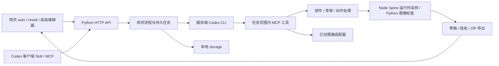

# 平台架构

| 模块 | 代码位置 | 职责 |
| --- | --- | --- |
| API 与网页服务 | app/server.py | HTTP 路由、资源读写、后台线程启动 |
| 网页任务 | app/web_workflows.py | 会话、提交、微调、原记录聚合 |
| 自动编排 | app/agent_tasks.py、agent/workflow-instructions.txt | Codex CLI 后台执行、任务隔离、预算、验收门禁 |
| 草稿交付 | app/workflow_delivery.py | 原记录关联、独立验收状态、版本历史 |
| 角色与骨架 | app/character.py、app/rig.py、app/rig_automation.py | 部件导入、组装、独立编辑副本、导出 |
| 图像服务 | app/provider.py、app/reference_*.py | 亿创调用、参考图发布、幂等查询与下载 |
| 复检 | app/review_bundle.py、app/runtime_cache.py、tools/ | 帧图、接缝局部、实际接地诊断、摘要缓存 |
| 网页 | web/auto.*、web/result.*、web/rig.* | 小白制作入口、结果预览、可选高级编辑 |
| 外部调用 | agent/spine_mcp.py、skills/ | MCP、CLI、Skill、安装与打包 |

运行流程：准备侧向参考与三视图/部件 → 视觉检查 → 组装绑定 → 待机/行走 → 运行时与放大图复检 → 定向修复 → 交付。确定性的操作、持久化与预算由平台执行；身份、自然步态及复杂遮挡仍需 Codex 视觉判断，不能用加载成功代替美术验收。

持久化使用文件与原子 JSON 写入。后台 Agent 队列在单个服务进程中顺序消费，不应直接启动多个进程共用 storage 来扩容；跨机器生产部署需要额外的共享队列、锁和持久层设计。
